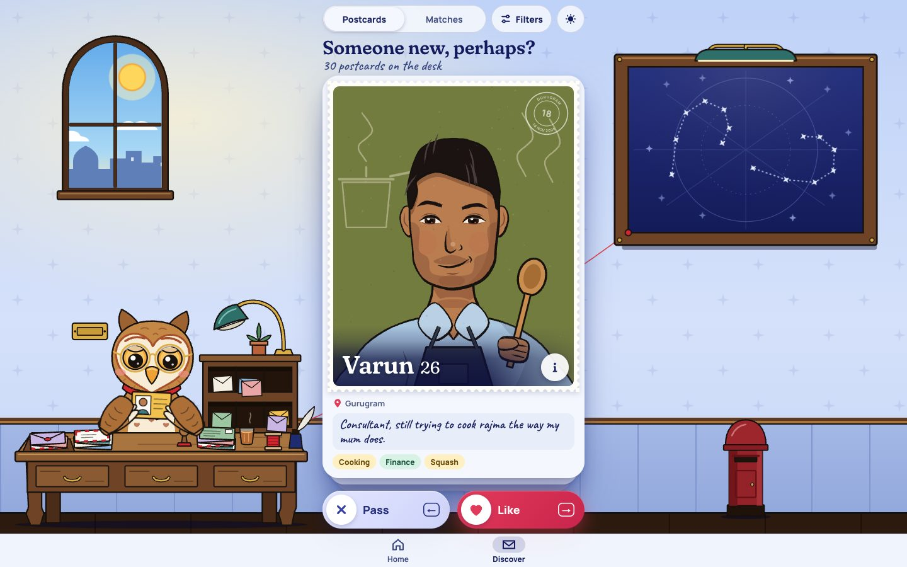
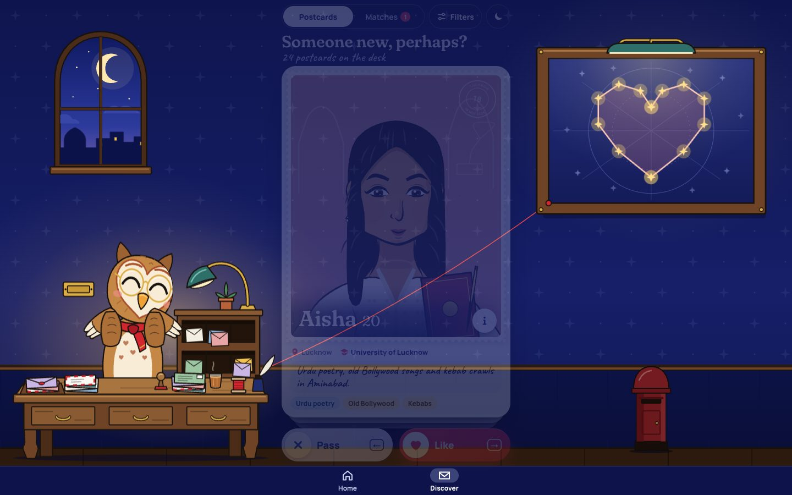
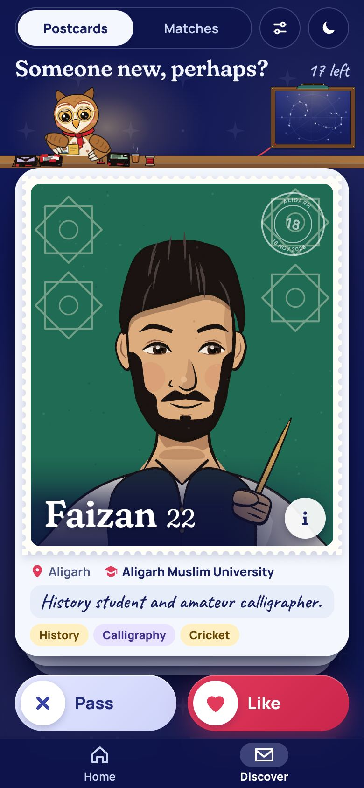
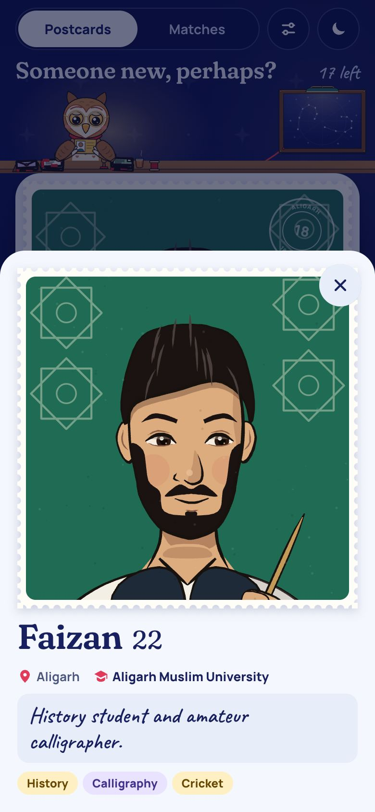
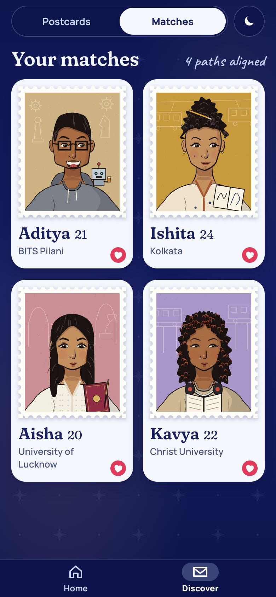
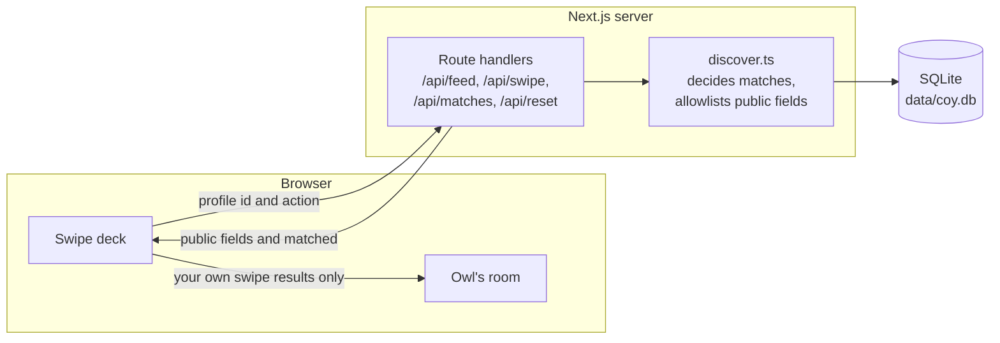

# Coy Discover

**A swipe deck that never tells you who liked you until the like is mutual.**

This is my take-home for the Coy SDE intern role. It's a standalone app built for the assignment: it isn't Coy's product, and it uses none of Coy's code, logo or brand assets. The 30 people in it are fictional.



**[Read the project story](docs/project-story.md)**: the problems, decisions and every real error behind this app, in SOART format.

## How it works

Discover shows one postcard at a time. Drag it right to like and left to pass, or use the buttons or the arrow keys. A match happens only when both people have liked each other, and only the server can decide that.

Behind the deck, an owl sorts postcards at a desk and checks a constellation board. It reacts to your own swipes. When the server confirms a match, two halves of the board join into a heart and the "It's a match!" screen opens.



The room follows your device's clock: bright from 6:00 am to 6:30 pm, and dark the rest of the time. A round button next to Filters switches between the clock, always day and always night.

<table>
  <tr>
    <td></td>
    <td></td>
    <td></td>
  </tr>
</table>

## Status

| Part of the brief | Status | Where |
|---|---|---|
| Part A: use the Coy app and suggest two core features | In progress | [docs/part-a-feature-suggestions.md](docs/part-a-feature-suggestions.md) |
| Tab bar with a blank Home tab and a Discover tab | Done | [AppShell.tsx](src/components/AppShell.tsx) |
| At least 30 seeded profiles, some of whom already liked you | Done: 30 profiles, 8 likers picked at random | [seed.ts](src/lib/server/seed.ts) |
| Swipe deck: drag on mobile, buttons on desktop, smooth animation | Done | [SwipeCard.tsx](src/components/SwipeCard.tsx) |
| A swiped profile never comes back, and the deck has an empty state | Done | [discover.ts](src/lib/server/discover.ts), [DeckEnd.tsx](src/components/DeckEnd.tsx) |
| A match only when both sides liked, with an "It's a match!" screen | Done | [discover.ts](src/lib/server/discover.ts), [MatchScreen.tsx](src/components/MatchScreen.tsx) |
| Matches view | Done | [MatchesView.tsx](src/components/MatchesView.tsx) |
| `GET /feed`, `POST /swipe`, `GET /matches` | Done, under `/api` | [src/app/api](src/app/api) |
| Swipes and matches survive a reload | Done: stored in SQLite | [database.ts](src/lib/server/database.ts) |
| Never reveal who liked you unless it's mutual | Done, with tests | [Privacy](#the-privacy-promise) |
| Tried on a real phone | Not yet | [Known limits](#known-limits) |

## Run it

You need [Node.js](https://nodejs.org) 22.13 or newer. There is no database to install and no environment file to set up. I've only run it on Node 26.10.0.

```bash
git clone https://github.com/ashutosharma2/coy-discover-assignment.git
cd coy-discover-assignment
npm install
npm run dev
```

Open [http://localhost:3000](http://localhost:3000). The first request creates `data/coy.db` and fills it with the seeded profiles.

Eight of the 30 profiles have already liked you, and they are picked at random. Liking 5 profiles at random gives at least one match about 82% of the time (calculated, not measured). When you reach the end of the deck, **Start over** clears your swipes and matches and picks new likers.

| Command | What it does |
|---|---|
| `npm run dev` | Starts the app in development mode |
| `npm run build` and `npm start` | Builds the app and runs the production version |
| `npm test` | Runs the 104 tests |
| `npm run lint` | Checks the code style |
| `npm run typecheck` | Checks the TypeScript types |
| `npm run reset` | Deletes the local database, so the next request seeds a new one with new ids |
| `npm run avatars` | Redraws the 30 portraits in `public/avatars/` |

## The privacy promise

Anything sent to the browser can be read in the Network tab, so hiding a field in the interface isn't privacy. The rule has to hold on the server.

| How a like could leak | What stops it |
|---|---|
| A "liked you" field in a response | One allowlist function builds the eight public fields, and database rows are never sent as they are |
| Likers appearing first in the feed | The feed is shuffled with Fisher–Yates on every request |
| Ids that follow the seed order | Every profile gets a random UUID |
| Likers readable in this public repo | Likers are picked when the database is seeded, so they exist only in the database |
| A pass that looks different for someone who liked you | Both passes get byte-for-byte the same response |
| Like someone, see the match, then take it back | Swipes are final, and a changed swipe gets the same 409 for everyone |
| Swiping as someone else | The server decides who "me" is, and the request can't name the swiper |
| The owl reacting to an incoming like | The scene never receives a profile, and it waits the same way for every swipe |

[Section 12 of the architecture notes](docs/architecture.md#12-ways-a-like-could-leak-and-what-stops-each-one) lists every case and how each one was checked.

## Architecture

It's one Next.js app. The browser only ever talks to the route handlers, and only the server modules can reach the database.



**[All 14 architecture diagrams](docs/architecture.md)** cover the data model, what reaches the browser, how a swipe is decided, and what happens when a reply is lost.

### API

| Request | Body | Answer |
|---|---|---|
| `GET /api/feed` | None | `{ "profiles": [...] }`: profiles you haven't swiped on, in a new random order |
| `POST /api/swipe` | `{ "profileId": "...", "action": "like" }` or `"pass"` | `{ "matched": true }` or `{ "matched": false }` |
| `GET /api/matches` | None | `{ "matches": [...] }`: mutual matches only, newest first |
| `POST /api/reset` | None | `{ "success": true }`: clears your swipes and matches for another run |

The brief's `GET /feed`, `POST /swipe` and `GET /matches` live under `/api`, which is the Next.js convention. `POST /api/reset` is my addition for replaying the demo.

Errors have one shape, `{ "success": false, "message": "..." }`. The status is 400 for a bad request, 404 for an unknown profile, 409 for a changed swipe and 403 for a reset sent from another site. Repeating the same swipe is safe and returns the original answer.

## Key decisions

Each decision has a record with the problem, the alternatives and what happened.

| Decision | Record |
|---|---|
| The server decides matches, and nothing it sends reveals an incoming like | [ADR-001](docs/adr/001-server-decides-matches.md) |
| Swipes are final | [ADR-002](docs/adr/002-swipes-are-final.md) |
| SQLite through Node's built-in `node:sqlite` | [ADR-003](docs/adr/003-sqlite-with-node-sqlite.md) |
| Next.js route handlers, with database code marked server-only | [ADR-004](docs/adr/004-nextjs-route-handlers-server-only.md) |
| Random ids, likers picked at seed time and a shuffled feed | [ADR-005](docs/adr/005-random-ids-likers-at-seed-time-shuffled-feed.md) |
| Two tabs, with the deck held above them | [ADR-006](docs/adr/006-two-tabs-deck-above-them.md) |
| An unknown swipe is settled by sending the same swipe again | [ADR-007](docs/adr/007-unknown-swipe-sends-same-swipe-again.md) |
| Motion for the drag | [ADR-008](docs/adr/008-motion-for-the-drag.md) |
| Portraits drawn in code (replaced the DiceBear avatars in [ADR-009](docs/adr/009-lorelei-avatars-generated-once.md)) | [ADR-010](docs/adr/010-portraits-drawn-in-code.md) |
| An owl in one illustrated room (replaced the pigeon in [ADR-011](docs/adr/011-pigeon-behind-the-deck.md)) | [ADR-012](docs/adr/012-owl-in-one-room.md) |
| A portrait-led deck, filters on the card's fields and a room that follows the clock | [ADR-013](docs/adr/013-postcard-deck-and-clock-theme.md) |
| Start over from inside the app | [ADR-014](docs/adr/014-start-over-from-the-app.md) |

## Project layout

```text
src/
  app/              the page, global styles and the four API routes
  components/       the deck, cards, sheets, Matches and navigation
  components/scene/ the owl, desk, board and room
  lib/client/       deck state, retries, filters, theme and the owl's animation logic
  lib/server/       database, seed and swipe rules (never sent to the browser)
scripts/avatars/    the code that draws the 30 portraits
tests/              Vitest tests for the rules, the routes and the browser logic
docs/               architecture diagrams, decision records and the project story
```

## Tests

`npm test` runs 104 tests: 19 on the swipe rules, 19 on the HTTP routes and 66 on the browser logic. They check the promises above directly, including that a pass on someone who liked you is byte-for-byte the same as any other pass, and that only a confirmed match can show the heart.

The linter, the type checker and a production build also pass. I checked the screens in a browser at 13 sizes, up to 1920 × 1080.

## Known limits

- **It hasn't been on a real phone.** Touch, layout and animation were checked with phone emulation in desktop Chrome. Battery use hasn't been measured.
- **Only Node 26.10.0 has been tested.** Node 22.13 and newer should work according to Node's documentation, but I haven't run them.
- **Some state lasts only until a reload.** The new-match count and the postcards pinned on the owl's board reset. Swipes and matches stay.
- **The day and night times are fixed.** They don't follow the real sunset, because that would mean asking for your location.
- **The campus filter is narrow.** Each campus in the seed data has one person.

### What a real deployment would need

The brief asks for one logged-in user and no sign-in, so this app has none of the following:

- sign-in and a session for each user
- rate limiting on the API
- a hosted database, because serverless hosts don't keep a SQLite file between requests
- a way to turn off or protect `POST /api/reset`

## Cost

₹0. The app uses no paid service, API or hosting plan, and it runs on your own machine.
