# Coy Discover architecture diagrams

## Summary (SOART)

- **Scenario:** Coy Discover is a swipe-based Discover tab, built as a take-home for the Coy SDE intern role. It must only match on a mutual like and never reveal who liked the user before that.
- **Obstacle:** the privacy guarantees live in a few SQL queries, one transaction and one allowlist function. Without pictures it's hard to see where a like is stored, what reaches the browser and where a match is decided.
- **Action:** one diagram per view, drawn from the code as it is after the backend phase (commit `cedb7fa`). Solid lines and boxes are built; dashed ones are planned.
- **Result:** you can follow a swipe from the request to the committed rows, see exactly which fields reach the browser, what happens on a double tap or a changed swipe, and how the database is seeded and reset. Section 12 lists each way a like could leak and what stops it.
- **Troubleshooting:** the diagrams are only useful while they're accurate, so they're updated at the end of every phase, alongside the README.

**Contents**

1. [System context](#1-system-context)
2. [What runs where](#2-what-runs-where)
3. [Server modules](#3-server-modules)
4. [Data model](#4-data-model)
5. [What reaches the browser](#5-what-reaches-the-browser)
6. [Loading the feed](#6-loading-the-feed)
7. [Liking someone who already liked you](#7-liking-someone-who-already-liked-you)
8. [How a swipe is decided](#8-how-a-swipe-is-decided)
9. [Swipe states for one profile](#9-swipe-states-for-one-profile)
10. [A double tap, then a changed swipe](#10-a-double-tap-then-a-changed-swipe)
11. [Seeding and reset](#11-seeding-and-reset)
12. [Ways a like could leak, and what stops each one](#12-ways-a-like-could-leak-and-what-stops-each-one)
13. [The Discover UI (planned)](#13-the-discover-ui-planned)
14. [Tests](#14-tests)

---

## 1. System context

Who and what Coy Discover deals with. The brief has no sign-in, so there's one logged-in user. Coy's real app isn't connected: this is a standalone app with no access to Coy's code. Until the Discover UI is built, the API is reached with curl and the tests.

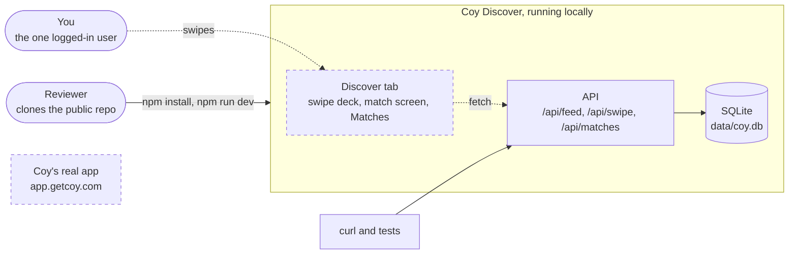

Coy's app is drawn dashed and unconnected on purpose: nothing links the two.

## 2. What runs where

Everything runs in one Node.js process. The database is a single file that's created and seeded on the first request.

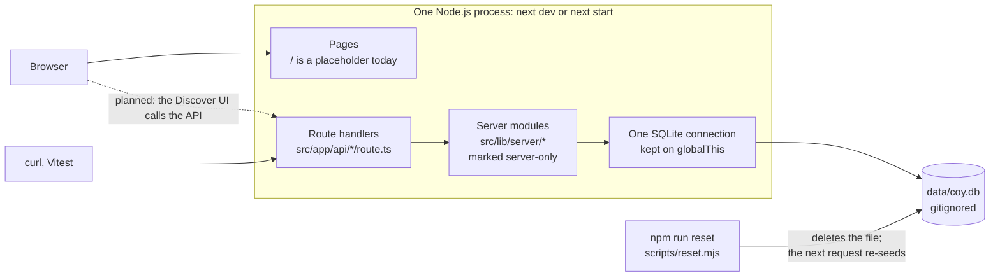

## 3. Server modules

Every module that touches the database or the seed starts with `import "server-only"`, so the build fails if browser code imports one ([ADR-004](adr/004-nextjs-route-handlers-server-only.md)). Only `types.ts` and `random.ts` are safe for the browser. All three routes, and `seed.ts`, also read `ME_ID` from `database.ts`; those arrows are left out to keep the picture readable.

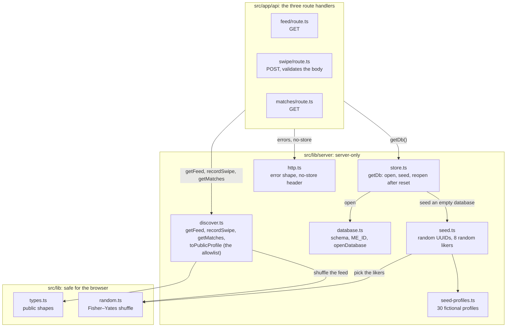

## 4. Data model

Three tables. Who liked whom is a row in `swipes`, which only the server reads. Each pair has at most one swipe in each direction (the primary key) and at most one match, because the two ids are stored in sorted order ([ADR-003](adr/003-sqlite-with-node-sqlite.md)).

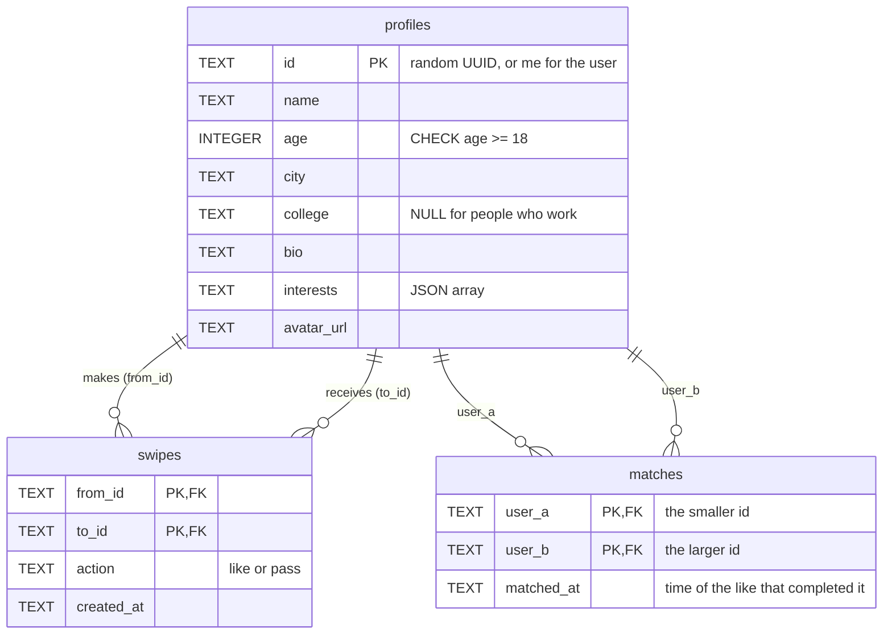

Two checks the diagram can't show: `swipes` has `CHECK (from_id <> to_id)`, and `matches` has `CHECK (user_a < user_b)`.

## 5. What reaches the browser

The trust boundary. Anything on the browser side can be read in DevTools, so only the allowlisted fields and the match result cross it ([ADR-001](adr/001-server-decides-matches.md)).

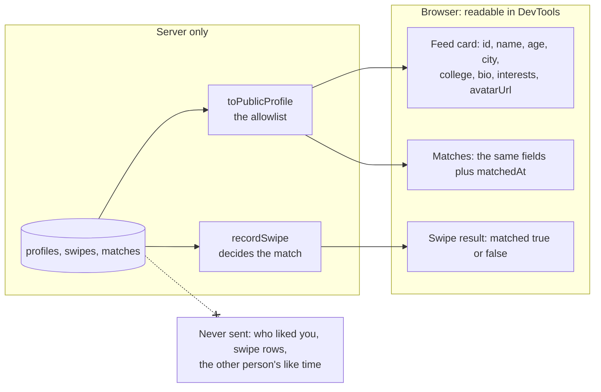

`matched` is only true when the like is mutual, which is the moment the brief says to reveal it.

## 6. Loading the feed

The feed query only reads the user's own swipes. It never reads anyone's likes of the user, so the order and contents of the feed can't depend on them.

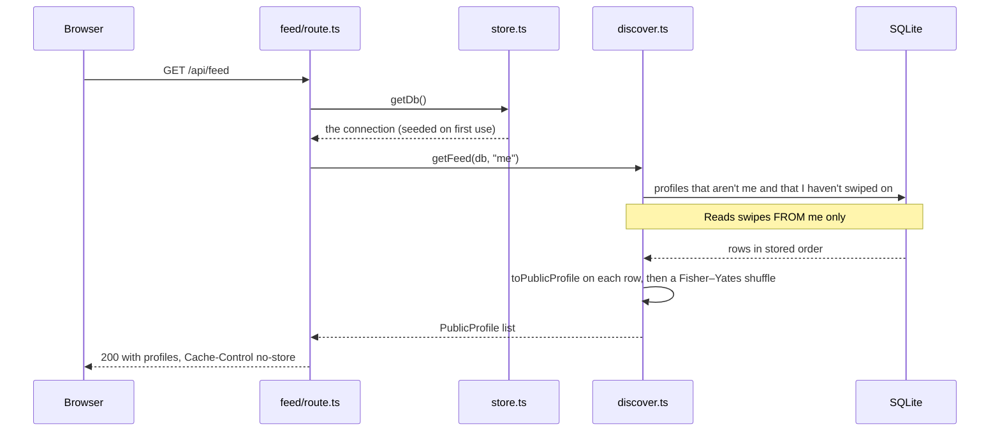

## 7. Liking someone who already liked you

In this example Ananya is one of the 8 profiles picked at seed time to have liked the user. The browser learns it only from `matched: true`, after the user has liked her back.

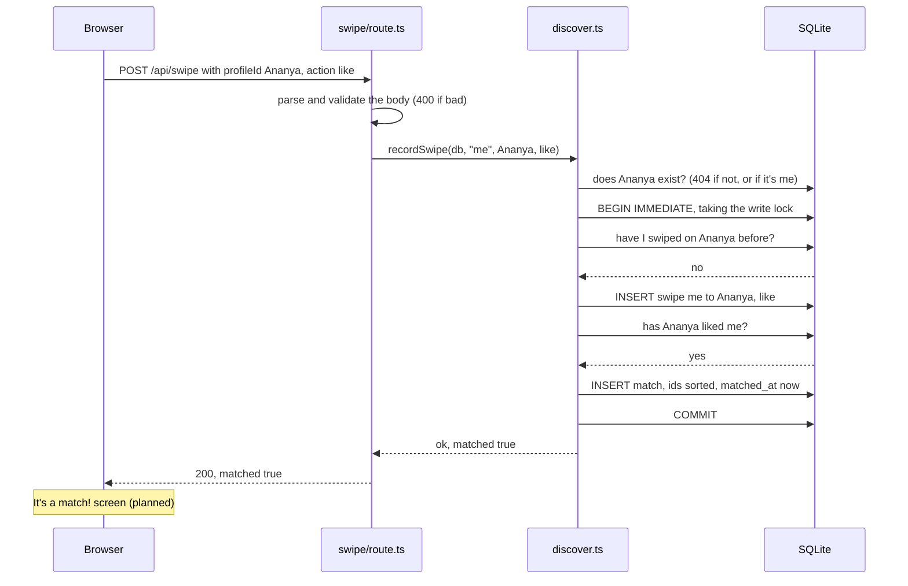

## 8. How a swipe is decided

Every path through `POST /api/swipe`. A pass returns before the server looks up whether the other person liked the user, so even the timing of a pass can't depend on it.

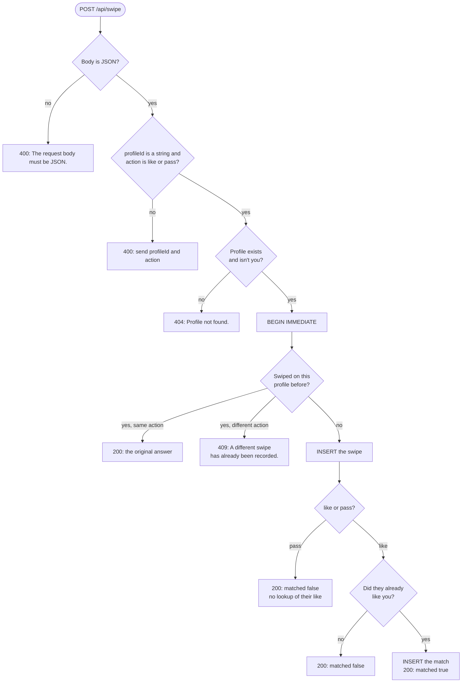

## 9. Swipe states for one profile

Every swipe is final ([ADR-002](adr/002-swipes-are-final.md)).

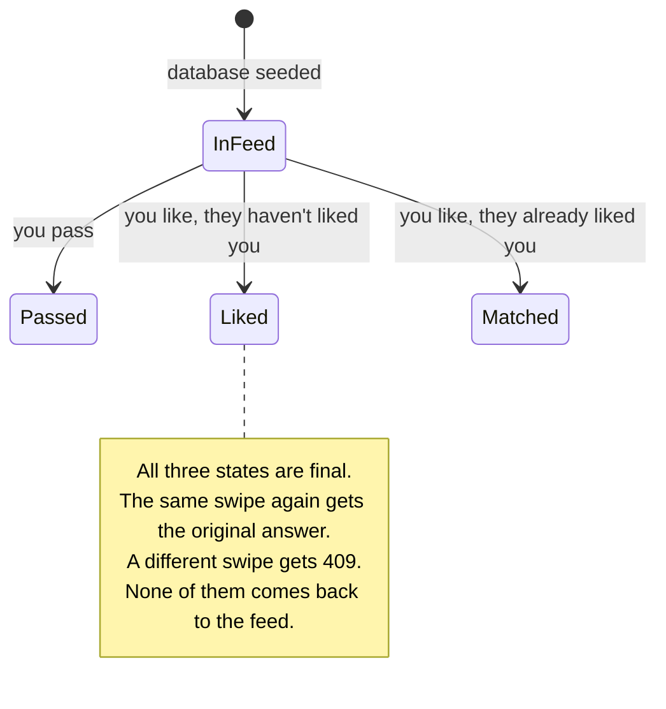

In a two-sided app, Liked would become Matched when the other person liked you later. Here the seeded profiles never swipe after seeding, so that can't happen.

## 10. A double tap, then a changed swipe

A drag release and a button tap can send the same like twice. The second gets the first one's answer. A later pass on the same profile is refused.

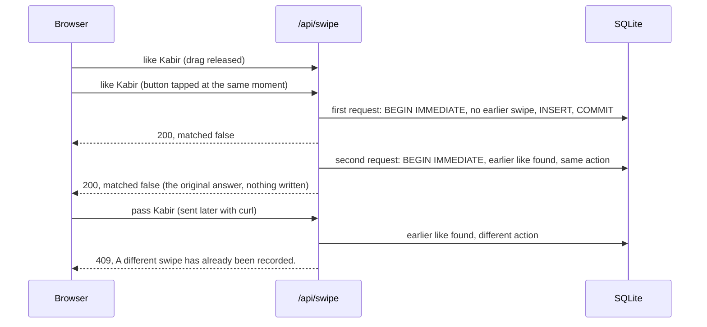

`node:sqlite` is synchronous, so inside one Node process the two requests run one after the other anyway. `BEGIN IMMEDIATE` and the primary key protect the data if more than one process ever writes.

## 11. Seeding and reset

The database creates and seeds itself, so a reviewer only runs `npm install` and `npm run dev`. Ids and likers are new on every seed ([ADR-005](adr/005-random-ids-likers-at-seed-time-shuffled-feed.md)).

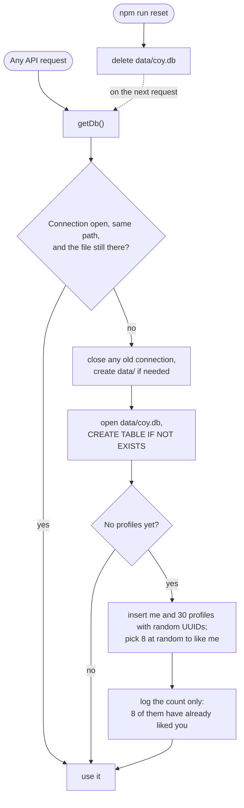

## 12. Ways a like could leak, and what stops each one

| Leak | What stops it | Checked by |
|---|---|---|
| A "liked you" field in a response | `toPublicProfile` builds eight fields; rows are never sent as they are | Tests: exact key set for feed and matches |
| Likers first in the feed | Fisher–Yates shuffle on every request | Test: likers' average position over 2,000 feeds |
| Ids that follow seed order | A random UUID for every profile on every seed | Test: ids are version 4 UUIDs |
| Likers readable in the public seed file | Likers are picked when seeding and exist only in the database | Test: different seeds pick different likers |
| A pass that looks different on a liker | A pass returns `matched: false` before any lookup | Test: byte-identical HTTP responses |
| Like, see the match, then pass to take it back | Swipes are final; a change gets 409 | Tests: conflicts for likers and non-likers |
| Error messages that depend on the other person | Fixed 400, 404 and 409 messages | Test: identical 409 bodies |
| Swiping as someone else | The server fixes who "me" is; the body can't name the swiper | Test: a `fromId` in the body is ignored |
| Guessing an endpoint such as `/likes` | Three API routes, none of which returns swipes | `next build` lists the three routes |
| Database or seed code shipped to the browser | `server-only` on every server module; nothing in `public/` | A client import failed the build (checked once, 2026-11-17) |
| Timing a request | A pass never looks up their like; a like already returns the answer | Not tested; reasoned from the code |

## 13. The Discover UI (planned)

Not built yet. The API calls on the right exist; everything dashed is still to be designed in step 2, including the drag gesture, the animation and the avatars.

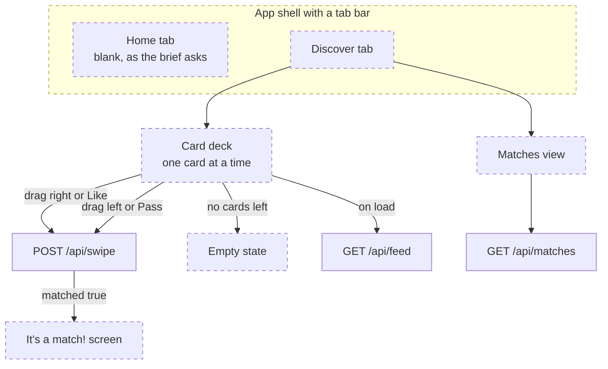

## 14. Tests

32 Vitest tests, run with `npm test`. Three deliberate bugs (no shuffle, likers sorted first, a changed swipe overwriting the first) each made tests fail before the code was restored.

| File | Tests | What it covers |
|---|---|---|
| [tests/discover.test.ts](../tests/discover.test.ts) | 17 | The logic on an in-memory database: seeding, feed contents and fields, the shuffle and its fairness, every swipe rule, matches |
| [tests/routes.test.ts](../tests/routes.test.ts) | 15 | The HTTP layer on a temporary database file: status codes, bodies, headers, a `fromId` in the body, persistence across a restart, reset |
